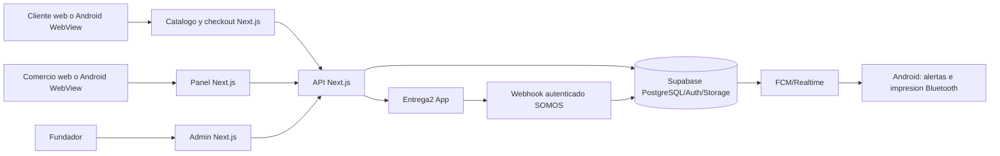

# Arquitectura actual

Base y limites: [README](README.md), [cobertura](cobertura-y-validacion.md).
Este mapa distingue implementacion encontrada de operacion comprobada.

## Aplicaciones y fronteras

| Parte | Implementacion y entradas | Datos/servicios | Estado de evidencia |
| --- | --- | --- | --- |
| Web SOMOS | Next.js 16/React 19/TypeScript/Tailwind; `src/app`, `src/components`, `src/lib` | Supabase Auth, PostgREST, Storage, RPC, Vercel | Codigo revisado por areas; seis recorridos publicos de lectura comprobados |
| Android SOMOS | `mobile/somos-android`, Capacitor 8, Java en `android/app/src/main/java/com/somosve/app` | WebView remoto, Bluetooth termico, FCM, puente nativo | Implementacion leida parcialmente; APK/dispositivos no probados en esta fase |
| Base SOMOS | 165 archivos `supabase/migrations`; tablas, RLS, triggers y RPC | PostgreSQL/Supabase | Migraciones inventariadas; catalogo/ordenes de produccion consultados antes de esta auditoria, esquema desplegado no reconciliado integralmente |
| Despliegue | `vercel.json` define dos cron; `.github/workflows`, `next.config.ts`, `src/proxy.ts` | Vercel, Supabase | Configuracion de codigo leida; variables y jobs reales no certificados |
| Scripts | 104 archivos bajo `scripts` | Importaciones, QA, mantenimiento | Inventariados, solo suites focales ejecutadas |

El CRM administrativo ENTREGA2 en la carpeta hermana **no** es parte de esta
aplicacion. La conexion real es el puente SOMOS/Entrega2 bajo
`src/app/api/integrations/entrega2` y `src/lib/server/entrega2-*`.

## Diagrama de contexto

La app Android toma su origen remoto de `mobile/somos-android/server-config.ts`:
produccion `www.somos-ve.com`, preview HTTPS restringido y local separado.
`MainActivity.java` registra `SomosPrinterPlugin`, `SomosOrderAlertsPlugin` y
`SomosBuyerAuthPlugin`; por tanto no es solo un acceso directo web. Una caida
o cambio incompatible del sitio remoto afecta a versiones Android instaladas.

## Datos y responsabilidades

- Tienda/catalogo: `stores`, `categories`, `products`, `product_variants`,
  grupos/valores de opciones y `product_inventory_skus`. Lectura principal en
  `src/lib/supabase/catalog.ts`; edicion en `/api/panel/products`, opciones e
  inventario. La comprobacion final de carrito vive en
  `src/lib/server/cart-review.ts` y el stock atomico en `create_order_atomic`.
- Compra: `/api/orders` recalcula productos, opciones, tarifa delivery, fee y
  moneda; `src/lib/server/create-order-atomic.ts` llama RPC transaccional para
  `orders`, `order_items` y seleccion de inventario. Pedido manual tiene otra
  entrada `/api/panel/orders` y fee cero en su payload.
- Operacion: `orders` conserva estado general, pago y delivery por separado;
  `order_kitchen_tickets`, `transport_orders` y `order_integrations` guardan
  estados especializados. `transition_order_status_v3`,
  `update_order_payment_v2` y `operate_kitchen_order` son contratos SQL.
- Cobro SOMOS: `orders.platform_service_fee_usd` es snapshot del cargo; pagos
  aprobados en `store_subscription_payments` y `loadServiceFeeBalances` calculan
  saldos. Afiliados agregan RPC y triggers propios. Las cifras de admin usan
  otras RPC de resumen; no asumir equivalencia sin comparacion por periodo.
- Identidad: Supabase Auth mas `store_users`, sesiones de panel firmadas,
  `requirePanelAuth` y `requireAdminAuth`. El proxy protege navegacion, las API
  deben volver a autorizar operacion y `store_id`.
- Archivos: Storage para logos, fotos, comprobantes; bucket de comprobantes
  privado con URL/lectura autorizada y cron de limpieza. Politicas desplegadas
  no auditadas completamente en esta fase.

## Integraciones verificadas en codigo

| Integracion | Evidencia | Estado que puede afirmarse |
| --- | --- | --- |
| WhatsApp | `src/lib/whatsapp.ts`, confirmacion de pedido y registro | Generacion/enlace de mensaje; no equivale a envio automatizado ni confirmacion de lectura |
| Entrega2 | `order-integrations`/webhook, `entrega2-bridge`, despacho en panel | Implementada y probada en suite; falta inyeccion de fallos entre escrituras |
| Otras empresas delivery | `transport_orders`, panel transporte, reglas y conexiones | Implementacion propia; cada proveedor/configuracion exige verificacion independiente |
| Pagos | medios configurables, referencias, comprobantes y estado de pago | Registro/verificacion manual; comprobante no acredita fondos por si mismo |
| FCM/impresion | `panel_push_devices`, `printing-agent`, Java nativo | Implementados; entrega fisica y compatibilidad por dispositivo no medidas aqui |
| Interpretacion de pedidos | `/api/panel/orders/interpret` y `OPENAI_API_KEY` | Entrada presente; disponibilidad real depende de configuracion; no es WhatsApp entrante automatico |

Variables detectadas por nombre, no por valor: `NEXT_PUBLIC_SUPABASE_URL`,
`NEXT_PUBLIC_SUPABASE_ANON_KEY`, `SUPABASE_SERVICE_ROLE_KEY`,
`PANEL_SESSION_COOKIE_SECRET`, `DELIVERY_QUOTE_SIGNING_SECRET`,
`ENTREGA2_WEBHOOK_SECRET`, `ENTREGA2_API_KEY`, `FIREBASE_SERVICE_ACCOUNT_JSON`,
`CRON_SECRET`, `FOUNDER_EMAILS`, claves de Turnstile/BCV/Google/OpenAI. Las
`NEXT_PUBLIC_*` son publicas por diseno; las demas deben permanecer del lado
servidor. No se registran valores.
